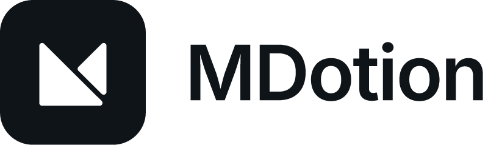
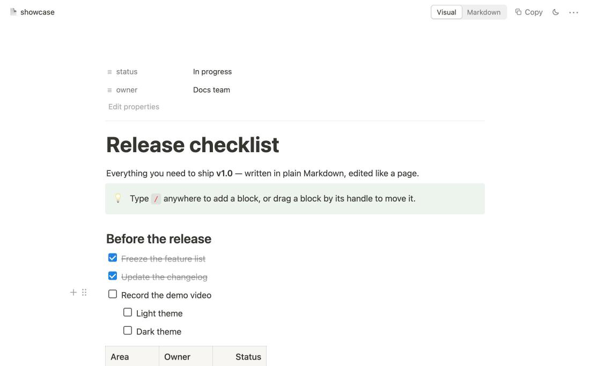
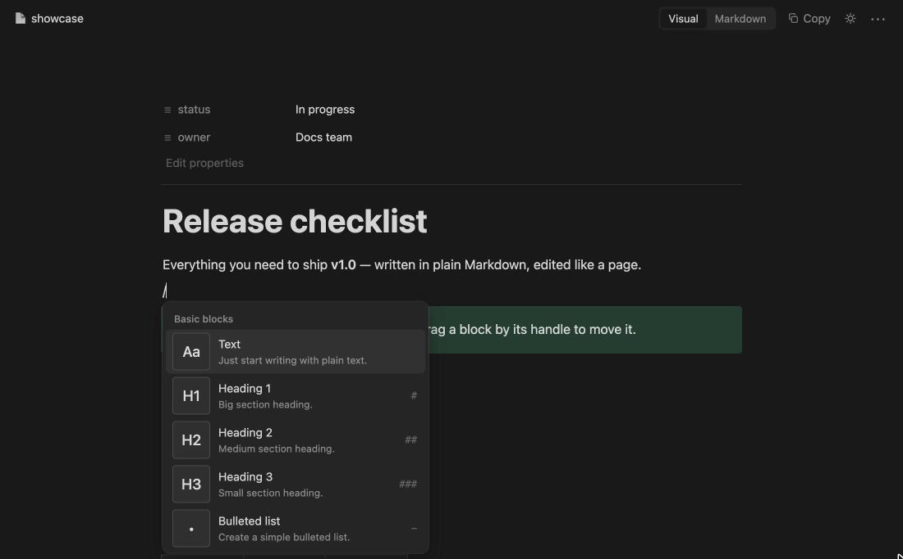
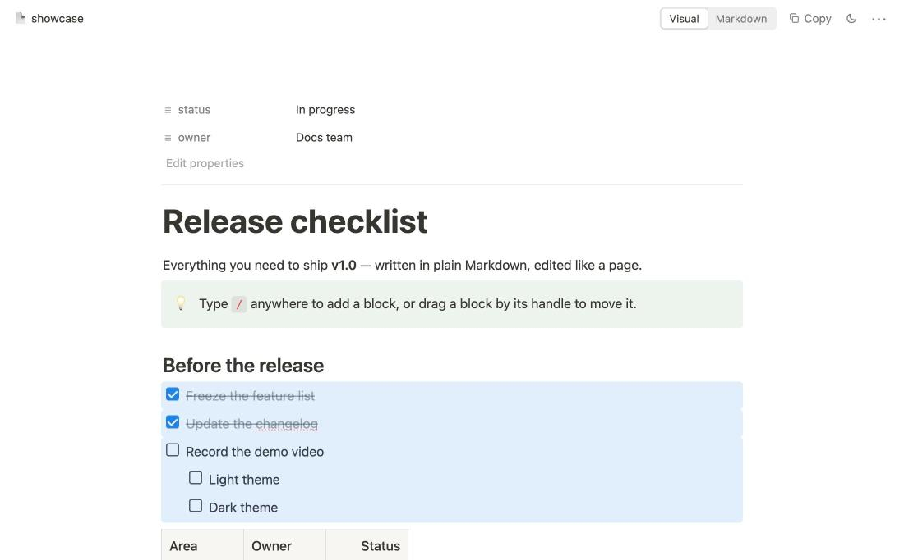

<p align="center">
  <picture>
    <source media="(prefers-color-scheme: dark)" srcset="https://github.com/SebastianI5/mdotion/raw/HEAD/images/logo-dark.png">
    
  </picture>
</p>

# MDotion

[](LICENSE)
[](https://code.visualstudio.com/)

Notion-style visual editing for **plain Markdown** (`.md`) inside **VS Code** and **Cursor**.
Files stay portable Markdown on disk — no account, no cloud, no proprietary format — and the blocks you don't touch are written back byte for byte, so Git diffs stay clean.



> **Preview** — MDotion is young (0.x). Your files are always plain Markdown and the source editor is one click away, but please [report](https://github.com/SebastianI5/mdotion/issues) anything that looks wrong.

## Features

- **Notion UI** — centered page, the first `# H1` as page title, Notion typography and colours, light / dark theme switch (sun / moon button; **Auto** follows the IDE), full-width, small-text, serif and mono page options (`•••`).
- **Slash menu** (`/`) — text, headings, bulleted / numbered / to-do lists, quote, callout, code, divider, table, image, with search and keyboard navigation.
- **Block handles** — hover a block for `+` (add below, ⌥-click above) and `⋮⋮` (drag to move, click for Turn into / Duplicate / Move / Copy as Markdown / Delete).
- **Block selection** — drag across blocks or from the margin, `Esc`, `Shift+↑/↓`, `⌘A` twice; selected blocks can be copied, deleted, duplicated, moved or converted together.
- **Selection toolbar** — Turn into, bold, italic, strikethrough, code, link (`⌘K`).
- **Markdown shortcuts** — `# `, `- `, `1. `, `[] `, `> `, ` ``` `, `---`, plus `⌘B/I/E`, `⌘⇧S`, `⌘⌥1–3`, `⌘⇧7/8/9`, `⌘↵` (toggle to-do), `⌘D` (duplicate), `⌘⇧↑/↓` (move block), `Tab` / `⇧Tab` (indent).
- **Callouts** stored as GitHub alerts (`> [!NOTE]`, `TIP`, `IMPORTANT`, `WARNING`, `CAUTION`).
- **Code blocks** with language picker, syntax highlighting and copy button; **tables** with row / column controls; **images** with relative paths and captions (alt text).
- **Front matter** shown as page properties and edited as YAML.
- **Nothing is lost** — HTML, reference definitions, badges and anything the editor cannot represent are kept verbatim as source blocks, with a sanitized preview.
- **Copy as Markdown** — anything you copy pastes as formatted Markdown elsewhere; pasting Markdown creates blocks.
- **Switch & copy** — **Visual | Markdown** toggle (`⌘⌥M` / `Ctrl+Alt+M`) replaces the tab in place; **Copy** (`⌘⇧⌥C` / `Ctrl+Shift+Alt+C`) copies the whole file. (On editors older than VS Code 1.100 a file with unsaved changes opens in a second tab instead, so nothing is discarded.)
- **Real files** — edits go through the IDE `TextDocument`: save, dirty state, undo in the source editor and Git work as usual; external changes appear live without moving the caret; conflicts never overwrite silently.

## Installation

- **VS Code:** install **MDotion** from the [Visual Studio Marketplace](https://marketplace.visualstudio.com/items?itemName=SebastianIrimia.mdotion), or run `ext install SebastianIrimia.mdotion` in Quick Open.
- **Cursor, VSCodium and other editors using Open VSX:** install it from [Open VSX](https://open-vsx.org/extension/mdotion/mdotion).
- **From source:** `npm install && npm run package`, then **Extensions → ⋯ → Install from VSIX…** (requires Node.js 20.11+).

Requires VS Code 1.85 or later (or an editor built on it).

## Getting started

MDotion never takes over your Markdown files on its own:

- open any `.md` file and click the **book** icon in the editor title bar, the **MDotion** status bar item, or press `⌘⌥M` / `Ctrl+Alt+M`;
- the first time you open a Markdown file, MDotion asks whether it should become your **default Markdown editor**. You can change this at any time with **MDotion: Use as Default Markdown Editor** / **MDotion: Stop Using as Default Markdown Editor**.

| Slash menu (dark theme) | Block selection |
|---|---|
|  |  |

## Commands

| Command | ID | Shortcut |
|---|---|---|
| MDotion: Open Visual Editor | `mdotion.openVisualEditor` | |
| MDotion: Open Markdown Source | `mdotion.openSource` | |
| MDotion: Switch Visual / Markdown Editor | `mdotion.toggleEditor` | `⌘⌥M` / `Ctrl+Alt+M` |
| MDotion: Copy All Markdown | `mdotion.copyMarkdown` | `⌘⇧⌥C` / `Ctrl+Shift+Alt+C` |
| MDotion: Use as Default Markdown Editor | `mdotion.useAsDefault` | |
| MDotion: Stop Using as Default Markdown Editor | `mdotion.stopUsingAsDefault` | |

Also available from the editor title bar, the status bar, the explorer context menu and **Reopen Editor With…**. Shortcuts can be changed in **Keyboard Shortcuts**.

## Settings

| Setting | Values | Default |
|---|---|---|
| `mdotion.theme` | `auto` (follow the IDE), `light`, `dark` | `auto` |

## Supported Markdown

CommonMark + GFM (tables, task lists, strikethrough, autolinks) and GitHub alerts are editable visually; everything else is preserved verbatim. Details in [ADR-008](docs/adr/008-mvp-capability-guarantee.md).

## Privacy

MDotion runs entirely inside your editor. It collects no telemetry, makes no network requests of its own and never uploads your files. Remote images referenced by your Markdown are loaded by the editor preview like in any Markdown viewer, and links are opened only when you click them.

## Contributing

Contributions are welcome — bug reports, ideas and pull requests. Read [CONTRIBUTING.md](CONTRIBUTING.md) for the development setup, tests and conventions, and follow the [Code of Conduct](CODE_OF_CONDUCT.md). Please report security issues privately as described in [SECURITY.md](SECURITY.md).

Architecture notes and design decisions live in [docs/adr](docs/adr/README.md).

## License

MDotion is released under the [MIT License](LICENSE).
It bundles open-source packages (Tiptap, ProseMirror, React, highlight.js, marked, zod and others) whose licenses are listed in [THIRD_PARTY_NOTICES.md](THIRD_PARTY_NOTICES.md).

The MIT License covers the source code. The MDotion name and logo (files in [`assets/`](assets/) and the derived images in `images/`) identify the project: you may use them to refer to MDotion, but not to brand forks or other products as if they were MDotion.

MDotion is an independent project and is not affiliated with or endorsed by Notion Labs, Inc. "Notion" is a trademark of its respective owner and is used here only to describe the editing style.
